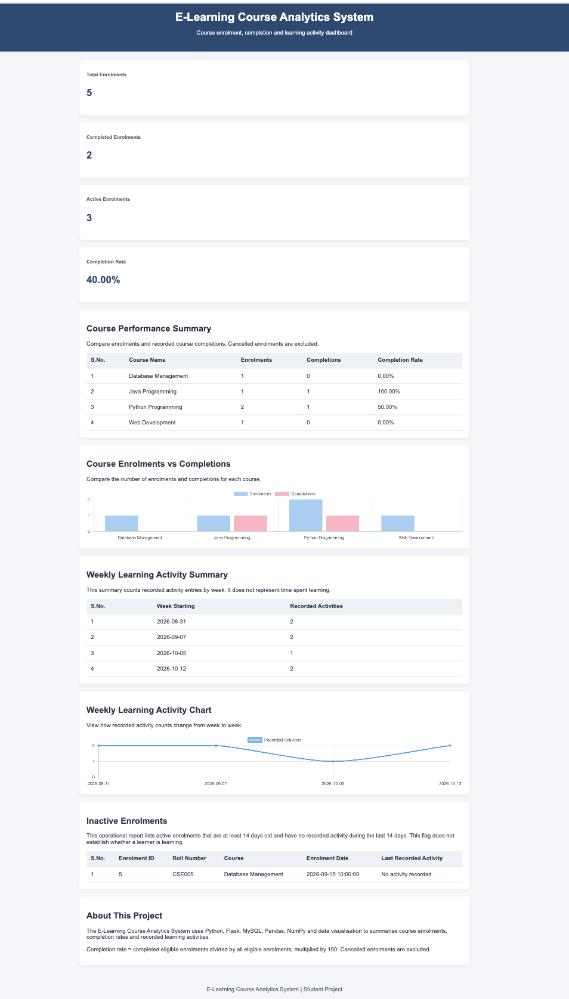

## Dashboard Preview



# E-Learning Course Analytics System

## Project Overview
The E-Learning Course Analytics System is a Python and MySQL-based project that analyzes course enrolments, learner progress, activity completion, and weekly learning activity.

It generates reports and visualizations to help administrators understand course participation and completion trends.

## Features
- Manage courses, learners, enrolments, and learning activities.
- Track activity completion and enrolment status.
- Compare enrolments and completions across courses.
- Generate weekly activity summaries.
- Identify inactive enrolments using a defined rule.
- Export analytics reports to CSV.
- Generate charts for course comparisons and weekly activity.
- Provide a Flask web interface and API endpoints.

## Technologies Used
- Python
- Flask
- MySQL
- Pandas
- NumPy
- Matplotlib
- HTML and CSS
- Chart.js

## Project Structure
- `app.py` — Flask application and API routes
- `analytics.py` — Data analysis and report generation
- `database.sql` — Database schema and setup
- `templates/` — HTML templates
- `static/` — CSS, charts, and static assets
- `reports/` — Generated reports and charts
- `test_app.py` — Automated application tests
- `requirements.txt` — Python dependencies

## Setup Instructions

1. Clone or download this repository.
2. Create and activate a Python virtual environment.
3. Install the dependencies:

   ```bash
   pip install -r requirements.txt
   ```

4. Create the MySQL database and tables using `database.sql`.
5. Start MySQL and run the Flask application:

   ```bash
   python3 app.py
   ```

6. Open `http://127.0.0.1:5001` in your browser if the application starts on port 5001.

The application asks for the MySQL password in the terminal when required.

## Run Tests

```bash
python3 -m unittest -v test_app
```

## Analytics Definitions and Acceptance Criteria

### 1. Course Completion Rate
Completion rate is calculated as:

Completion Rate = (Completed Eligible Enrolments / Total Eligible Enrolments) × 100

Cancelled enrolments are excluded from the denominator. Courses with zero eligible enrolments display 0% as a placeholder; this does not represent a measured completion rate.

### 2. Weekly Activity Summary
Recorded learning activities are grouped by week using their activity timestamps. The report counts recorded activities; it does not measure learning quality or ability.

### 3. Inactive Enrolment Rule
An enrolment is included in the inactive-enrolment report when:
- Its status is active.
- It was created at least 14 days ago.
- It has no recorded activity in the last 14 days.

### 4. Interpretation and Limitations
No recorded activity does not prove that a learner has stopped learning. Activity records may be incomplete, so inactivity is used only as a reporting indicator.

### 5. Generated Outputs
- `course_completion_report.csv`
- `weekly_activity_report.csv`
- `inactive_enrollments.csv`
- `weekly_activity.png`
- `course_comparison.png`

## Deployment

The application is deployed using Render, with a hosted MySQL database provided by Aiven.

Live Dashboard: https://elearning-analytics.onrender.com/

## Updating the Project

After making changes to the project, use the following Git commands to push updates to GitHub:

```bash
git status
git add .
git commit -m "Update project"
git push origin main
```

If automatic deployment is enabled in Render, pushing changes to the configured GitHub branch can trigger a new deployment.

**Security:** Do not commit database passwords, private keys, or other sensitive credentials to GitHub.

## Project Goal
To demonstrate database management, Python backend development, data analysis, report generation, and visualization using an e-learning analytics use case.